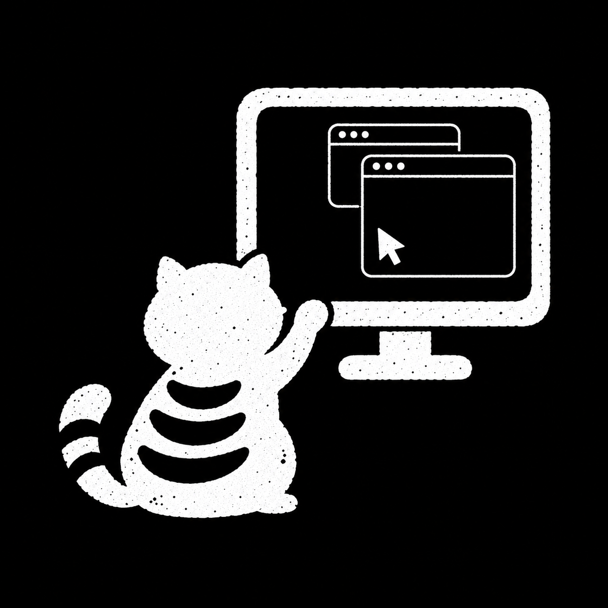

# da desktop

Let [Claude Code](https://code.claude.com) and [pi](https://github.com/earendil-works/pi) see and operate the apps on your own desktop. They read each app's accessibility tree instead of guessing at pixels, and act without taking your pointer or your focus.

<table>
  <tr>
    <td width="50%" valign="top"><b>No pixel guessing</b><br>The agent reads an app's accessibility tree and acts on named elements: <code>button "Save"</code>, not a coordinate in a screenshot.</td>
    <td width="50%" valign="top"><b>Stays out of your way</b><br>Actions go through the accessibility API. Your pointer does not move and your window keeps focus, unless you allow physical input.</td>
  </tr>
  <tr>
    <td width="50%" valign="top"><b>One namespace each</b><br>Run several Claude Code and pi sessions together. Every session keeps its own snapshots, so one agent's refs never work in another.</td>
    <td width="50%" valign="top"><b>Careful about retries</b><br>Every failure says whether the input may have landed. An agent repeats an action only when that is safe, so a click never submits twice.</td>
  </tr>
</table>

## Install

**Claude Code** (2.1.287 or newer)

```bash
claude plugin marketplace add Jeecabs/da-desktop
claude plugin install da-desktop@da-desktop
```

**pi**

```bash
pi install https://github.com/Jeecabs/da-desktop
```

**Both need** [agent-desktop](https://github.com/vercel-labs/agent-desktop) 1.3.1 or newer, and on macOS the Accessibility permission for the app your agent runs in:

```bash
npm install -g agent-desktop@latest
agent-desktop permissions --guide
```

Then run `/desktop status` in your agent, or just ask it to use an app.

## Ask for things like

- "Open Calculator and work out 17% of 2,340."
- "What's in the Downloads folder in Finder right now?"
- "In System Settings, turn on Reduce Motion."
- "Take a screenshot of the Xcode window and tell me what the error says."
- "Rename the selected Finder items to match the pattern in this file."
- "Click through the installer and stop at the licence step."

## Tools

18 tools, the same in both hosts. Full reference in [docs/tools.md](docs/tools.md).

| To | Use |
| --- | --- |
| See an app | `desktop_snapshot` `desktop_find` `desktop_get` `desktop_is` `desktop_screenshot` `desktop_list` |
| Act on it | `desktop_click` `desktop_type` `desktop_select` `desktop_act` `desktop_scroll` `desktop_press` |
| Get around | `desktop_app` `desktop_window` `desktop_wait` |
| Set up | `desktop_status` `desktop_clipboard` `desktop_command` |

`/desktop status` and `/desktop headed on|off` run without starting a turn.

## Skills

- **`desktop`** teaches the loop: map a dense app with a skeleton, drill into one region, act on a ref, then look again before trusting the result.

## Settings

| Variable | Default | Change it to |
| --- | --- | --- |
| `DA_DESKTOP_HEADED` | off | `1` to start every session with physical input allowed, as `/desktop headed on` does for one |
| `DA_DESKTOP_BIN` | `agent-desktop` | The path to another agent-desktop executable |

## Good to know

- It's your desktop, signed in as you. Agents act only when you ask, but whatever they do, they do as you.
- Snapshots, screenshots and the clipboard can hold private content. They land in your temp folder under `da-desktop/`, readable only by you. Look before you share one.
- Physical input moves your real pointer and takes focus, so it is off until you type `/desktop headed on`. No tool can turn it on.
- Typed text and clipboard writes are piped to agent-desktop, so they never show up in a process list.
- In Claude Code, running `agent-desktop` straight from Bash to read or drive the desktop is refused, because it would skip the session's namespace and the physical-input setting. `agent-desktop status`, `permissions`, `skills` and `--help` still run.
- Built and tested on macOS. agent-desktop also supports Windows and Linux, but da-desktop has not been run there.

## Development

```bash
pnpm install
pnpm check
pnpm test
claude plugin validate .
```

The tests need neither agent-desktop nor the Accessibility permission. How it's built, and the words it uses, are in [CONTEXT.md](CONTEXT.md).

<p align="center">
  
</p>
